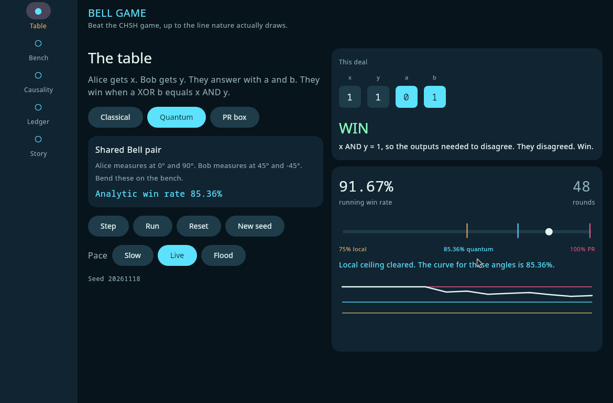
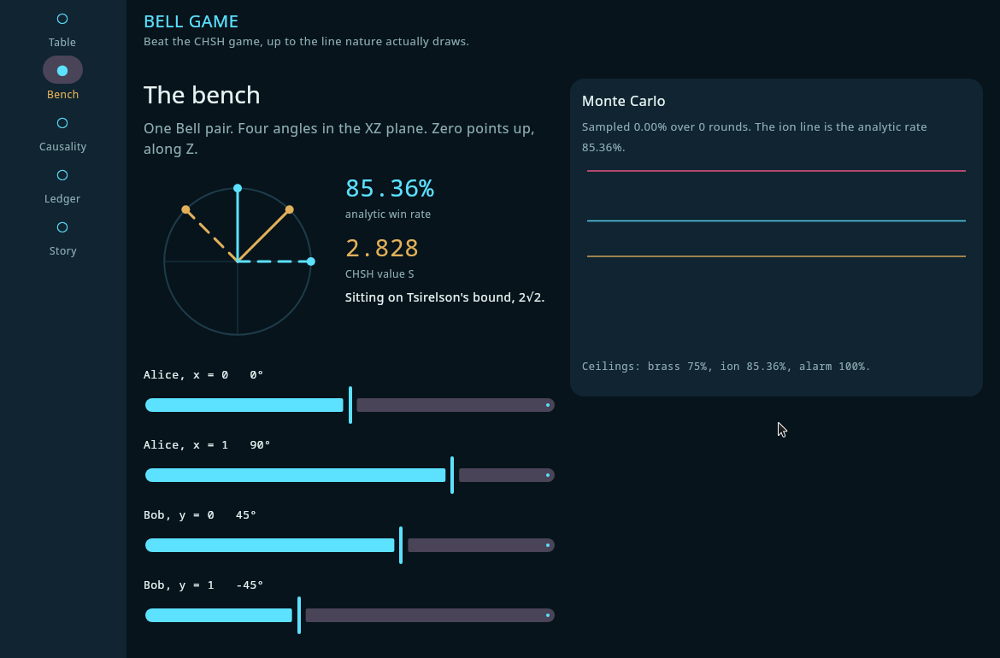
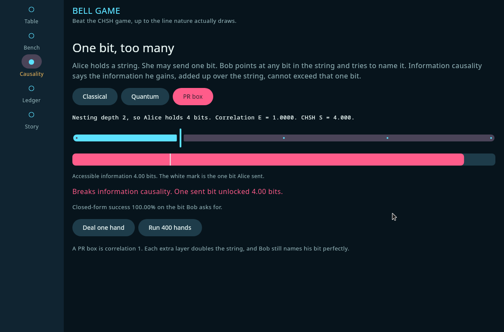
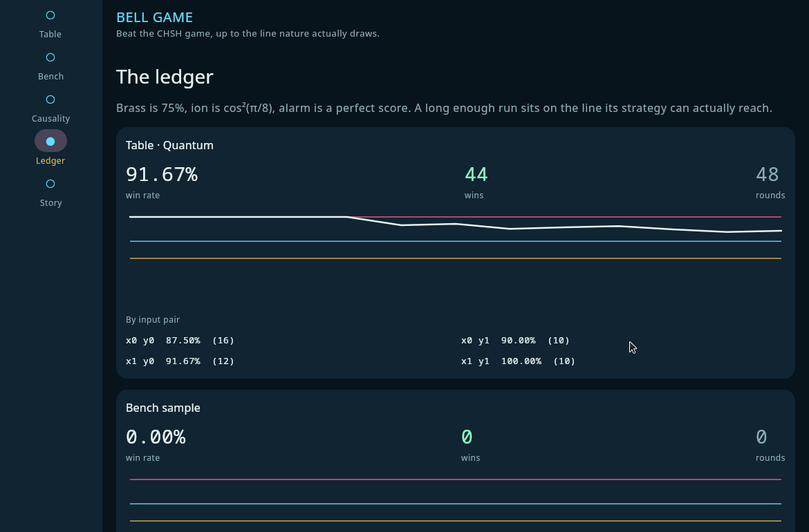
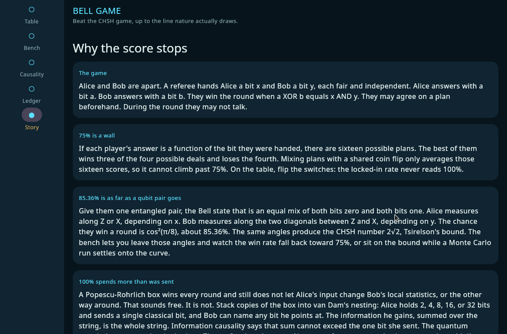

# Bell Game

Bell Game is a Kotlin Multiplatform exhibit about the CHSH game. Alice and Bob
each receive a random bit and each return a bit. They win the round when

```text
a XOR b  ==  x AND y
```

You play three regimes with the same rules:

1. **Classical.** Each output is a function of that player's own input. Over all
   16 deterministic plans, the best win rate is exactly 75%. Shared randomness
   only mixes those plans, so it cannot do better.
2. **Quantum.** They share one Bell pair, `|Φ+⟩ = (|00⟩ + |11⟩) / √2`, and
   measure spins in the XZ plane. The optimal angles (Alice at 0 and π/2, Bob
   at π/4 and −π/4) win with probability `cos²(π/8) ≈ 85.36%`. The CHSH
   correlator for those angles is `2√2`, Tsirelson's bound.
3. **Popescu-Rohrlich box.** A non-signaling box that wins every round
   (CHSH value 4). It is not a quantum strategy. The causality screen shows
   why: stack copies of it in van Dam's nesting and one classical bit from
   Alice lets Bob learn more about her string than she sent. The same nesting
   fed with the quantum correlation, or with the classical correlation, stays
   inside that one-bit budget.

Nothing in the running app asks for a key, an account, a config file, or a
network connection. Text on screen stays inside the font embedded with the
Wasm runtime, and the navigation marks are drawn circles, so the page does not
fetch a fallback face from fonts.gstatic.com. The physics and the interface
live in `commonMain`.

This repository is a private contest project. It is not published and it has
not been submitted anywhere.

## The physics, in plain words

Alice and Bob may plan ahead. Once the referee hands them their bits, they
cannot talk. If the plan says "always answer 0", they agree on every round.
The rules only ask them to disagree when both inputs are 1, so that plan wins
3 of the 4 possible deals. Every other local plan has the same ceiling. You
can see it on the table: the four switches are the whole strategy, and the
locked-in rate never reads 100%.

Entanglement changes the kind of plan they share. They do not share a list of
answers. They share a pair of qubits in one joint state, and each of them
measures their own qubit at an angle chosen from their own input. For the Bell
state above, the chance their outcome bits agree is `cos²` of half the angle
between the two measurements. The four optimal angles make that chance equal
`cos²(π/8)` on every input that wants agreement, and the matching chance of
disagreement on the one input that wants it. That is the 85.36% line. No
choice of angles on one pair of qubits gets past it.

The PR box is the strategy that would. It forces the outputs to have exactly
the parity the rules want, while each player's output, looked at alone, is
still a fair coin. Winning every round sounds free. The causality screen prices
it. Alice holds `2ⁿ` bits. Each level of nesting uses one box per pair of bits
and leaves her with a shorter string, until one bit remains and she sends it.
Bob, who only queried the pairs that contain the index he cares about, xors
that bit with his box outputs. With perfect boxes he names the bit exactly, so
the information he can reach is the whole string: 2, 4, 8, 16, 32 bits from a
one-bit message. Information causality says that sum cannot exceed the message.
A box whose correlation is the quantum value `1/√2` (the same strength as the
optimal angles) keeps the sum at or under one bit. A classical box of
correlation `1/2` does too.

The simulator does not call out to a quantum library. A two-qubit state is four
complex amplitudes. A measurement is a projection onto a spin direction
`cos(θ) Z + sin(θ) X`, and the probability is the squared modulus of the
amplitude. The same seed deals the same rounds on every target.

## Screenshots

Desktop captures of the five screens. Regenerate them with the app running
and any screenshot tool; the harness below opens each screen directly.











The captures in this folder were taken from the desktop app on Linux. Android
and the browser render the same composables.

## Run it

You need a JDK 17 or newer. This project is built and run with JDK 21. No API
keys, no `local.properties` secrets, and no accounts.

From the repository root:

```bash
./gradlew :composeApp:run
```

That opens the desktop window. Optional, and not required:

- `BELL_SCREEN=bench` (or `causality`, `ledger`, `story`, `table`) opens that screen.
- `BELL_PRELOAD=1` deals 400 quantum rounds into the score that screen shows.
  On the bench, that is the bench sample. On every other screen, it is the
  table ledger, and the regime switches to quantum.

```bash
BELL_SCREEN=bench BELL_PRELOAD=1 ./gradlew :composeApp:run
```

### Desktop distribution

```bash
./gradlew :composeApp:createDistributable
```

The app image lands under `composeApp/build/compose/binaries/main/`. Launch the
`BellGame` binary inside the `app` directory for the current OS. Packaging a
`.deb` as well:

```bash
./gradlew :composeApp:packageDeb
```

`packageDeb` needs both `dpkg-deb` and `fakeroot` on the machine. Without
`fakeroot` the Debian packager cannot build the archive. `createDistributable`
does not need either tool. The package version is `1.0.0`.

### Android

Install the Android SDK (command-line tools are enough) and either export
`ANDROID_HOME` or put `sdk.dir` in `local.properties`. The app's `minSdk` is
24 and `compileSdk` is 37. Still no keys.

```bash
export ANDROID_HOME="$HOME/Android/Sdk"   # or wherever the SDK lives
./gradlew :androidApp:assembleDebug
```

The debug APK is

```text
androidApp/build/outputs/apk/debug/androidApp-debug.apk
```

Install it with `adb install -r` on a device or emulator, and launch
**Bell Game**. The launcher icon is two overlapping rings.

### Web (Wasm)

```bash
./gradlew :composeApp:wasmJsBrowserDevelopmentRun
```

Gradle prints a local URL. Open it. `#bench`, `#causality`, `#ledger`, and
`#story` select a screen. A production bundle, which you can open from a
static file server, is:

```bash
./gradlew :composeApp:wasmJsBrowserDistribution
```

The output is under `composeApp/build/dist/wasmJs/productionExecutable/`.

## Project structure

```text
composeApp/src/commonMain/kotlin/dev/eyeoverthink/bellgame/
  engine/     rules, strategies, two-qubit state, ledger, causality
  ui/         the exhibit: table, bench, causality, ledger, story
composeApp/src/commonTest/kotlin/     the checks below, shared
composeApp/src/desktopMain/           one window
composeApp/src/wasmJsMain/            one browser viewport, plus index.html
androidApp/src/main/                  the Android activity, manifest, and launcher icon
```

`composeApp` still compiles an Android library target so the app can depend on
the shared code. That target has no hand-written Kotlin. There is no `expect` /
`actual` split. The platform shells only start `BellGameApp`. Game rules, the
complex-amplitude simulator, sampling, the statistics, the
information-causality protocol, and the Compose UI are all in `commonMain`.

### How the shared-code share is counted

Count `.kt` lines under `composeApp/src` and the Android shell in
`androidApp/src`. Drop blank lines. Drop comments, including KDoc. A count
that keeps comments is higher and is not the figure below: on the first commit
that figure was 85.7% because comment lines were included. The same tree,
comments removed, was 83.9% of all Kotlin and 97.4% of production Kotlin.

On the current sources the non-comment count is:

| Source set | Non-comment lines |
| --- | ---: |
| `commonMain` | 1,836 |
| `commonTest` | 316 |
| `androidApp` | 15 |
| `desktopMain` | 18 |
| `wasmJsMain` | 15 |
| All Kotlin | 2,200 |
| Production (`commonMain` + the three shells) | 1,884 |

`commonMain` is 1,836 / 2,200 = **83.5%** of all Kotlin, and 1,836 / 1,884 =
**97.5%** of production Kotlin. `commonTest` is shared, but it is not part of
the production share. The Android activity is the application module; it is
still counted as the Android shell, so moving it out of `composeApp` does not
change the share. Recompute with:

```bash
python3 - << 'PY'
import re
from pathlib import Path
root = Path("composeApp/src")

def lines(paths):
    total = 0
    for path in paths:
        text = re.sub(r"/\*.*?\*/", "", path.read_text(), flags=re.S)
        text = re.sub(r"//.*", "", text)
        total += sum(1 for line in text.splitlines() if line.strip())
    return total

groups = {
    name: lines(list((root / name).rglob("*.kt")))
    for name in ("commonMain", "commonTest", "desktopMain", "wasmJsMain")
}
groups["androidApp"] = lines(list(Path("androidApp/src").rglob("*.kt")))
production = groups["commonMain"] + groups["androidApp"] + groups["desktopMain"] + groups["wasmJsMain"]
everything = production + groups["commonTest"]
print(groups)
print(f"commonMain / all Kotlin: {groups['commonMain'] / everything:.1%}")
print(f"commonMain / production: {groups['commonMain'] / production:.1%}")
PY
```

The Kotlin Multiplatform contest starter kit (Koko) was not used as a base.
It is a Firebase, sign-in, and purchases template. Bell Game is a
self-contained exhibit and does not want those services.

## Tests and lint

```bash
./gradlew :composeApp:desktopTest
./gradlew :composeApp:testAndroidHostTest
./gradlew :composeApp:ktlintCheck :androidApp:ktlintCheck
./gradlew :composeApp:detekt :androidApp:detekt
```

`desktopTest` runs the common tests on the JVM. The same tests run on the
Android host classpath with `:composeApp:testAndroidHostTest`. They check:

- the best of the 16 local tables is exactly 0.75, and no table exceeds it
- the optimal qubit strategy is `cos²(π/8)` analytically, the CHSH value is
  `2√2`, and a seeded Monte Carlo run lands within 2 percentage points
- the PR box wins every sample, and its marginals do not signal
- the nested protocol is perfect for a PR box, matches the closed form for a
  noisy box, and the information sum exceeds one bit for the PR box while
  staying at or under one bit for the quantum and classical correlations

Format the sources with `./gradlew ktlintFormat`. Detekt's formatting rules
are off so ktlint owns style; detekt still fails the build on complexity,
naming, magic numbers in the engine, and the other default checks. Config:
`config/detekt/detekt.yml`. Editor defaults: `.editorconfig`.

Wasm browser tests are disabled. They would rerun the same common tests inside
a browser, and the JVM run is the one the commands above execute. Compiling
the Wasm target still typechecks that shared code.

## Tooling

Kotlin 2.4.21, Compose Multiplatform 1.12.2, JDK 21, Android Gradle Plugin
9.3.1, compileSdk 37. All of it is free. There is no analytics SDK and no
runtime HTTP client.

The Android APK is built by `androidApp`, which applies `com.android.application`
and depends on `composeApp`. The activity, manifest, and launcher icon live in
that module. The shared module is an Android KMP library
(`com.android.kotlin.multiplatform.library`), so it does not also apply the
application plugin. That is the AGP 9 layout: `android.builtInKotlin=false` and
`android.newDsl=false` are not set.

## License

[MIT](LICENSE). Copyright 2026 Vaughn Scott.
